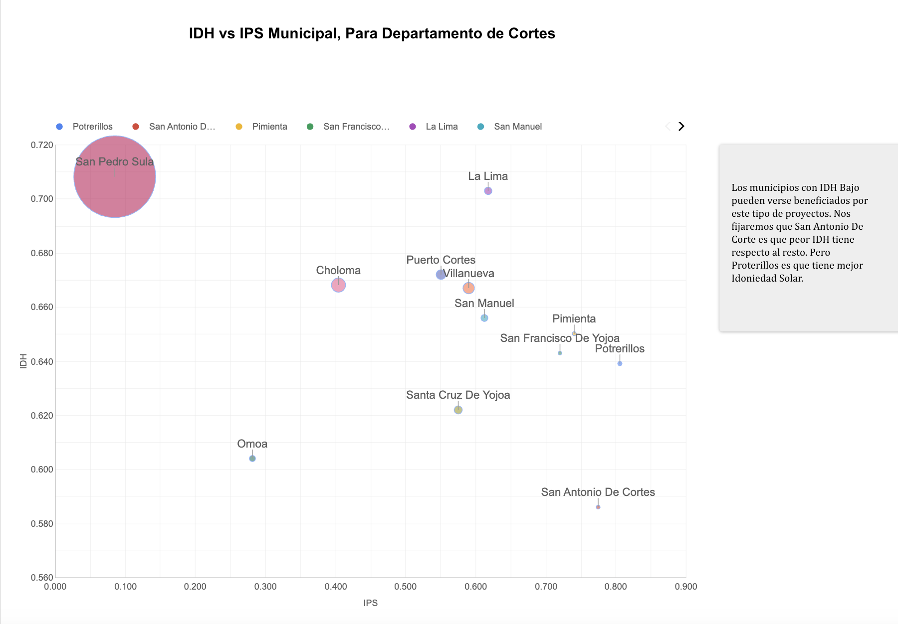
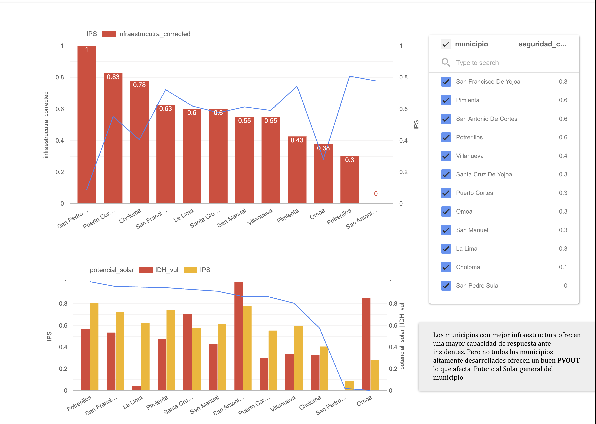
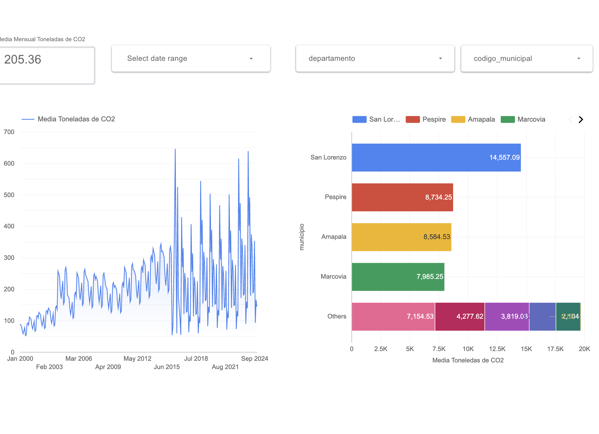

# ☀️ Honduras Solar Potential & Energy Access (SDG 7)


A data science project that evaluates solar energy potential and electricity access in **Cortés, Honduras**, aligned with **UN Sustainable Development Goal 7 (Affordable and Clean Energy)**. It combines public energy, emissions, climate, and socioeconomic data to identify where a solar project would have the greatest impact and to size a solar-plus-storage system for unserved households.

📊 **[Interactive dashboard (Looker Studio)](https://datastudio.google.com/reporting/a80ef7c7-2e7c-4c84-93f3-52faba73be21)**

Note: You may need a google account to look at the data due to Data Studio Limitations. 





<!-- Add a screenshot of the Looker Studio dashboard here -->

---

## Key Results

- **25,124 households** in Cortés without electricity access (ICAEH 2024 report).
- **Proposed system:** 31.29 MWp PV (bifacial modules) with a 25 MW / 100 MWh battery (4-hour discharge at the evening peak), generating an estimated **49.75 GWh/year**.
- **Solar potential:** average PVOUT of **1,589.81 kWh/kWp/year** across the target area.
- **Municipal prioritization:** a Solar Prioritization Index (IPS) ranks the 12 municipalities of Cortés. **Potrerillos** and **Pimienta** show good infrastructure and low climate risk, making them strong candidates for initial projects.
- **Power Issues**: The analysis concluded the the country a has high potential for solar power but lacks of the required BLESS Infraestructure for high capacity energy storage. This according to Time Series analysis of Energy Production by source and CND statements. 

## Problem

Cortés has one of the highest levels of CO₂ emissions in Honduras, and demand for electricity keeps growing with GDP (known as PIB in spanish). Many households remain without grid access, often relying on firewood, charcoal, or kerosene, which causes indoor air pollution and health risks. The project asks: **where should a solar project be built first, and how large should it be to serve unelectrified households reliably?**

## Methodology

1. **Data collection:** Gathered 16 public datasets covering electricity coverage (ICAEH), national dispatch (CND), emissions (EDGAR), solar resource (Global Solar Atlas, NASA POWER), demographics and development (UNDP, UNAH, World Bank), and climate risk (INFORM).
2. **Cleaning and extraction:** Extracted tables from government PDF reports (Camelot, pypdf), processed NetCDF emission grids, and computed zonal statistics per municipality.
3. **Spatial analysis:** Intersected raster layers with administrative boundaries (GDB/GeoJSON) to calculate solar potential per municipality.
4. **Modeling:** Forecast of residential electricity demand versus GDP and population (2024–2040).
5. **Prioritization:** Built a multi-criteria **IPS** that weights solar potential, climate safety, grid infrastructure, and adaptive capacity, then compared it with social vulnerability and HDI rankings.
6. **System sizing:** Sized PV capacity and storage from household demand (167 kWh/month per home), the PV capacity factor, and the evening peak (19:00 h).
7. **Visualization:** Published the results as a Looker Studio dashboard.

## Notebooks

| # | Notebook | Purpose |
|---|---|---|
| 01 | `01_cobertura_electrica_icaeh.ipynb` | Exploratory analysis of electricity coverage; flags municipalities below 50% coverage |
| 02 | `02_generacion_despacho_electrico_honduras.ipynb` | Hourly dispatch and generation mix; seasonality and daily demand curve |
| 03 | `03_diagnostico_solar_municipal_cortes.ipynb` | Solar diagnostic (GHI, PVOUT) for the 12 municipalities of Cortés |
| 04 | `04_pronostico_demanda_pib_poblacion.ipynb` | Residential demand forecast based on GDP and population |
| 05 | `05_vulnerabilidad_social_cortes.ipynb` | Social vulnerability (HDI, IDS, NBI) at municipal level |
| 06 | `06_indicadores_riesgo_inform_honduras.ipynb` | Subnational INFORM risk indicators |
| 07 | `07_indice_priorizacion_solar_ips_cortes.ipynb` | Construction of the Solar Prioritization Index (IPS) |
| 08 | `08_emisiones_co2_sector_electrico.ipynb` | Power-sector CO₂ emissions from EDGAR NetCDF grids |
| 09 | `09_benchmark_chile_solar_urbanizacion.ipynb` | International benchmark: solar adoption and urbanization in Chile |

## Key Findings

- **Prioritization:** [Add 2–3 specific findings from notebook 07, e.g., top 3 municipalities and their IPS scores]
- **Demand vs. supply:** At 167 kWh/month per household, 25,124 homes need ~50 GWh/year, which matches the PV output of the proposed plant.
- **Energy mix:** Renewables supplied 55.4% of Honduras' 12.48 TWh net generation in 2024 (CND).

## Limitations

- EDGAR emissions are modeled estimates, not ground measurements.
- The PV capacity factor used by CND for small projects (0.12) differs from the site-specific PVOUT-based estimate; the report uses site-specific values.
- Household demand is an average (167 kWh/month) and does not reflect income or usage differences.
- Socioeconomic indicators are municipal averages and may hide differences within each municipality.

## Tech Stack

**Languages & analysis:** Python, pandas, NumPy
**Geospatial:** GeoPandas, Rasterio, rioxarray, Shapely, rasterstats, NetCDF4
**Visualization:** Matplotlib, Seaborn, Looker Studio
**Data extraction:** Camelot, pypdf, requests (REST APIs: Open-Meteo, GBIF)

## Repository Structure

```
honduras_solar_irradiation/
├── notebooks/     # Analysis notebooks (01–09) and drafts
├── utils/         # Reusable Python modules for extraction and processing
├── outputs/       # Figures, maps, and final tables (e.g., municipios_prioritarios_cortes.csv)
├── data/          # Raw and processed data (see Data section)
└── README.md
```

## Data

Raw data is not included in this repository because of file size. [Add the download link: Google Drive / Zenodo / .zip file]. Each dataset's source and license are documented in `data/README.md`.

## How to Run

```bash
# Create the environment (conda recommended for geospatial dependencies)
conda create -n ods7 python=3.10 -y
conda activate ods7

# Geospatial and NetCDF dependencies
conda install -c conda-forge geopandas rasterio rioxarray netcdf4 rasterstats shapely -y

# Analysis and visualization
pip install pandas numpy matplotlib seaborn requests pypdf "camelot-py[cv]" openpyxl
```

Then download the data, place it in `data/`, and run the notebooks in order (01 → 09).

## Skills Demonstrated

- Data cleaning and integration from heterogeneous sources (PDF, NetCDF, GeoTIFF, APIs, CSV)
- Geospatial analysis and zonal statistics
- Multi-criteria index design and municipal prioritization
- Time-series and econometric demand forecasting
- Dashboard design and data storytelling

## Author

**Diego Carcamo**: Data science student (UNITEC San Pedro Sula)
📧 diegofdiaz1717@outlook.com · 💼 [LinkedIn](https://www.linkedin.com/in/diego-carcamo-20396430a) · 🐙 [GitHub](https://github.com/DiegoC-Diaz)

## License

Code is released under [MIT / choose a license]. Each dataset is subject to its original source license (see `data/README.md`).